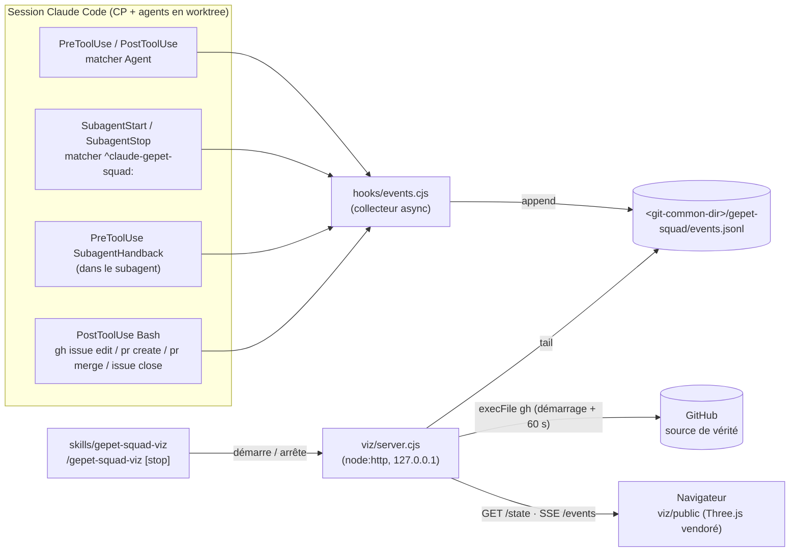

# Architecture — claude-gepet-squad : visualisation 3D temps réel (`/gepet-squad-viz`)

> Statut : validée par l'utilisateur le 2026-10-30. Toute évolution passe par un nouvel ADR.

## 1. Besoin

Le plugin `claude-gepet-squad` reçoit une nouvelle brique : une **visualisation 3D, en temps réel et en lecture seule**, du workflow d'un projet squad.

- **Utilisateur** : la personne qui pilote un projet squad depuis Claude Code, sur son poste (Windows, macOS ou Linux). Un seul utilisateur, en local.
- **Commande** : `/gepet-squad-viz` démarre un petit serveur Node local, puis affiche l'URL à ouvrir dans le navigateur. `/gepet-squad-viz stop` l'arrête.
- **Métaphore** : un pipeline abstrait de 7 stations, **Cadrage → Roadmap → Dev → Vérification → Test → Merge → Release**. Les features (issues) y circulent comme des objets. Les agents actifs (architecte, développeurs, vérificateur, testeur) y apparaissent comme des entités lumineuses.
- **Sources** :
  - les hooks du plugin écrivent un **journal d'événements local** (temps réel) ;
  - **GitHub** fournit l'état de fond au démarrage, puis un recalage périodique (labels `status:*` et `retry:*`, milestones, PR).
- **Volumétrie** : jusqu'à une centaine de features par projet, 3 agents en parallèle par défaut (`maxParallelDevs`), quelques dizaines d'événements par heure.
- **Contraintes** :
  - **aucun build et aucune dépendance npm à l'exécution** : le plugin s'installe tel quel ;
  - Three.js est vendoré ;
  - le serveur n'utilise que les modules standards de Node ;
  - prérequis inchangés : Node, `gh`, `git` ;
  - conventions du repo : français, bump de version et CHANGELOG à chaque changement de comportement.
- **Hors périmètre (MVP)** :
  - aucune action depuis la vue (lecture seule stricte) ;
  - pas de vue multi-projets ;
  - pas de rejeu historique navigable ;
  - pas d'hébergement distant ni de partage ;
  - pas de panneau intégré à Claude Code ;
  - pas de version mobile.

## 2. Vue d'ensemble

Il y a **trois briques et un seul flux de données**, à sens unique : hooks → journal JSONL → serveur → SSE → navigateur. Le serveur fusionne le journal avec un instantané GitHub obtenu par `gh`. Personne n'écrit vers GitHub.



**Comment on capte le cycle de vie des agents** (détail dans l'[ADR 0004](adr/0004-capture-cycle-de-vie-des-agents.md)). En phase 4, le CP lance les agents en arrière-plan. Pour ces agents, `PostToolUse` sur `Agent` se déclenche au **lancement**, avec `status: "async_launched"`. Le rapport final arrive ensuite par notification, et non dans `tool_response`. La fin d'un agent est donc captée ainsi :

1. par `SubagentStop`, qui est la source principale de fin d'agent : il porte `agent_id`, `agent_type` et `last_assistant_message` ;
2. par `PreToolUse` sur `SubagentHandback`, émis dans le subagent : `tool_input.message` contient le bloc de rapport (verdict, statut) ;
3. par les commandes `gh` que le CP lance après chaque rapport (transition `status:*`, merge, close) : elles font foi pour l'état des features ;
4. en repli, par `PostToolUse` sur `Agent` avec `status: "completed"`, pour les agents lancés en mode synchrone ;
5. en dernier recours, par le recalage GitHub toutes les 60 s, qui corrige toute dérive.

La capture réelle du 2026-10-30 confirme les points 1 et 2 en arrière-plan. Elle montre aussi qu'un agent repris par `SendMessage` enchaîne plusieurs cycles début → fin pour un même `agentId` : le cycle de vie n'est donc **pas monotone** ([ADR 0008](adr/0008-reprise-agent-cycle-non-monotone.md)).

## 3. Sous-projets

La structure du plugin (`hooks/`, `skills/`, `agents/`, `scripts/`) est imposée par Claude Code : on ne crée donc pas de layout `apps/`. Les scopes ci-dessous sont à déclarer dans `.gepet-squad.json`.

| Sous-projet (scope) | Dossier | Rôle | Expose | Consomme |
|---|---|---|---|---|
| `hooks` | `hooks/events.cjs`, `hooks/lib/`, entrées dans `hooks/hooks.json` | Collecteur : transforme les payloads de hooks en événements normalisés et les ajoute au journal. N'est actif que dans un repo qui contient `.gepet-squad.json`. Ne bloque jamais rien. | Le fichier `events.jsonl` (schéma v1, voir § 6) | Le stdin JSON des hooks Claude Code, `git rev-parse --git-common-dir` |
| `viz-server` | `viz/server.cjs`, `viz/lib/` | Serveur HTTP local en lecture seule. Il suit le journal, prend l'instantané GitHub, fusionne les deux dans un état et le pousse en SSE. | `GET /` (fichiers statiques de `viz/public`), `GET /state` (JSON), `GET /events` (SSE), `GET /health` | `events.jsonl`, CLI `gh` |
| `viz-web` | `viz/public/` (`index.html`, `js/`, `css/`, `vendor/three/`), plus `scripts/vendor-three.sh` | Front 3D. Modules purs (`state.js`, `layout.js`) séparés du rendu (`scene.js`, `labels.js`, `main.js`). | — | `GET /state`, `EventSource('/events')` |
| `skills` | `skills/gepet-squad-viz/SKILL.md`, plus la doc README et CHANGELOG | Commande utilisateur. Démarre le serveur en arrière-plan et affiche l'URL. Délègue l'unicité et l'arrêt aux sous-commandes `status` et `stop` de `viz/server.cjs` : le skill ne manipule aucun pid. | `/gepet-squad-viz [stop]` | CLI de `viz/server.cjs` (`[start]`, `status`, `stop`) |
| `repo` | racine : `package.json`, `eslint.config.mjs`, `.github/workflows/ci.yml`, `.gitattributes`, `tests/helpers/` | Outillage transverse : lint, suite de tests, CI | `npm test`, `npm run lint` | — |

Dépendances entre sous-projets :
- tous les scopes dépendent de l'outillage du scope `repo` ;
- `viz-server` dépend de `hooks` par deux modules, lus par chemin relatif :
  - le **schéma d'événement v1** (`hooks/lib/schema.cjs`) ;
  - `hooks/lib/journal.cjs`, qui fournit `findSquadRoot` (racine du projet squad) et la résolution du chemin du journal. Ces deux fonctions sont donc aussi un contrat entre scopes, qu'on ne modifie pas sans vérifier `viz-server` ;
- `viz-web` dépend du **contrat `/state` et SSE** exposé par `viz-server` ;
- `skills` dépend de la CLI de `viz/server.cjs`.

Le schéma d'événement v1 vit dans `hooks/lib/schema.cjs` : il appartient au scope `hooks`, qui le produit, et `viz-server` le lit par un chemin relatif. Le contrat `/state` appartient à `viz-server` (`viz/lib/reducer.cjs`, forme décrite au § 6). Ces deux contrats sont posés par leur première feature et ne changent ensuite que par un ADR.

## 4. Stack

| Sous-projet | Langage / version | Framework | Données | Tests unitaires | Tests d'intégration | Lint |
|---|---|---|---|---|---|---|
| `hooks` | Node.js ≥ 22 (LTS), CommonJS | aucun (modules standards) | Ajout de lignes à `events.jsonl` | `node:test` + `node:assert/strict` : normalisation de chaque type de payload (fixtures réelles), parsing des commandes `gh`, filtrage hors squad | `node:test` : exécution de `hooks/events.cjs` en sous-processus, avec un stdin de fixture, dans un repo git temporaire, puis vérification du journal écrit (rotation comprise) | ESLint 10 (`@eslint/js`, `globals`), flat config |
| `viz-server` | Node.js ≥ 22, CommonJS | aucun (`node:http`, `node:fs`, `node:child_process`) | Lecture du journal, instantané `gh` en mémoire | `node:test` : réducteur (fusion journal et instantané, priorité GitHub), mapping `status:*` → station, contrôle de l'en-tête `Host`, résolution des chemins statiques | `node:test` : serveur démarré sur un port éphémère, client SSE qui reçoit un événement ajouté au journal, `/state` avec un faux `gh` placé dans le `PATH`, refus d'un `Host` étranger et d'une traversée de chemin | ESLint 10 |
| `viz-web` | JavaScript ES2022, modules ES natifs | Three.js **0.187.0** vendoré (MIT) et ses addons | Modèle en mémoire | `node:test` sur les modules purs `state.js` (application d'un événement SSE) et `layout.js` (positions des stations, des files et des agents), sans DOM | Smoke manuel avec le navigateur intégré (skill `run`) : chargement, réception SSE, absence d'erreur console. Pas de test WebGL automatisé au MVP ([ADR 0006](adr/0006-strategie-de-tests.md)). | ESLint 10 (`vendor/` ignoré) |
| `skills` | Markdown (frontmatter skill) | — | — | — | `claude plugin validate .` | — |

## 5. Commandes

| Sous-projet | install | lint | build | test (suite complète) | démarrer |
|---|---|---|---|---|---|
| tous (racine) | `npm ci` (dev uniquement : ESLint) | `npm run lint` | — (aucun build) | `npm test` (= `node --test`) | — |
| `hooks` | `npm ci` | `npx eslint hooks` | — | `node --test "tests/hooks/*.test.cjs"` | déclenché par Claude Code via `hooks/hooks.json` |
| `viz-server` | `npm ci` | `npx eslint viz/server.cjs viz/lib` | — | `node --test "tests/viz-server/*.test.cjs"` | `node viz/server.cjs --project <dir> [--port 0]` ; `node viz/server.cjs status --project <dir> [--wait <s>]` (affiche l'URL si le pid du verrou est vivant, et nettoie un verrou périmé) ; `node viz/server.cjs stop --project <dir>` |
| `viz-web` | `npm ci` | `npx eslint viz/public/js` | — | `node --test "tests/viz-web/*.test.mjs"` | servi par `viz-server` |
| `skills` | — | — | — | `claude plugin validate .` | `/gepet-squad-viz` puis `/gepet-squad-viz stop` |

Vérifications du plugin, à lancer en plus sur chaque PR : `claude plugin validate .` et `bash -n scripts/bootstrap.sh`, plus le test du garde-fou décrit dans `CLAUDE.md`.

> Ce sont ces commandes exactes qu'utilisent le développeur et le testeur.
> Les globs restent entre guillemets : `node --test` les développe lui-même. Avec Node 22, un chemin de dossier nu (`node --test tests/hooks/`) est résolu comme un module, et la commande échoue.

Le `package.json` racine est `"private": true`. Il ne contient que des `devDependencies` (`eslint`, `@eslint/js`, `globals`) et les scripts `test` et `lint`. Le plugin ne l'exécute jamais chez l'utilisateur.

## 6. Données

Détail dans l'[ADR 0003](adr/0003-journal-evenements-et-etat-fusionne.md).

- **Journal** : `<git-common-dir>/gepet-squad/events.jsonl`, résolu par `git rev-parse --git-common-dir` depuis le `cwd` du hook. Ce dossier est commun à la session principale et aux worktrees des agents. Il n'est jamais commité et n'oblige pas à modifier le `.gitignore`.
  - On ajoute une ligne par événement, avec `fs.appendFileSync` : une écriture atomique pour les lignes de moins de 4 Ko.
  - Rotation au-delà de 5 Mo : `events.jsonl` devient `events.1.jsonl`, et on n'en garde qu'un seul ancien fichier.
- **Schéma d'événement v1**, dans `hooks/lib/schema.cjs` :
  `{ v: 1, ts, src: "hook", type, sessionId?, toolUseId?, agentId?, agentType?, mode?, issue?, pr?, attempt?, retry?, status?, verdict?, block?, source?, label?, ref? }`.
  - `attempt` : la valeur de `TENTATIVE:` extraite du prompt de mission (`agent.requested`). Ne pas confondre avec `retry`.
  - `retry` : un entier ≥ 1, le K du label `retry:K` posé sur l'issue. Porté uniquement par `feature.retry`.
  - `ref` : toujours une **chaîne**, dont le sens dépend du type (tableau ci-dessous). Il sert à transporter l'identifiant disponible au moment de la commande, alors que le numéro d'une PR ou d'une issue créée n'est connu qu'en sortie de commande.
  - `block` : l'en-tête du bloc de rapport, par exemple `RAPPORT_VERIFICATION` (`agent.reported`, ou `agent.finished` en repli).
  - `source` : uniquement sur `agent.finished`. Vaut `tool` (`PostToolUse` sur `Agent`, `status: "completed"`) ou `stop` (`SubagentStop`).
  - `toolUseId` désigne **uniquement** l'appel de l'outil `Agent` (`agent.requested`, `agent.launched`, `agent.finished` de source `tool`). `agent.reported` n'en porte pas : il est émis par l'appel `SubagentHandback` dans le subagent, et il est corrélé par `agentId`.

  Les types possibles :
  - `agent.requested` : `PreToolUse` sur `Agent` ;
  - `agent.launched` : `PostToolUse` sur `Agent`, `async_launched` ;
  - `agent.started` : `SubagentStart` ;
  - `agent.reported` : `SubagentHandback` ;
  - `agent.finished` : `SubagentStop`, ou `PostToolUse` sur `Agent` avec `completed` ;
  - `feature.status` : `gh issue edit --add-label status:*` ;
  - `feature.retry` : `--add-label retry:*` ;
  - `pr.opened` ;
  - `pr.merged` ;
  - `issue.closed` ;
  - `issue.created` ;
  - `milestone.changed` ;
  - `release.opened`.

  **Champs par type.** Les champs communs `v`, `ts`, `src`, `type` et `sessionId?` sont toujours présents, et `validate()` refuse tout champ hors de cette liste. Dans le tableau, ✔ indique un champ obligatoire et ? un champ optionnel.

  `validate()` contrôle seulement la version, le type, les champs connus et la taille de 4 Ko. Il ne vérifie pas les champs obligatoires par type. Ces champs obligatoires sont un engagement des **producteurs** (`normalize.cjs`, `gh-command.cjs`), vérifié par leurs tests unitaires. Côté consommateur, le réducteur doit tolérer un champ obligatoire manquant : il ignore alors l'événement, sans lever d'exception.

  | Type | Source | Champs propres |
  |---|---|---|
  | `agent.requested` | `PreToolUse` sur `Agent` | `toolUseId` ✔, `agentType` ✔, `mode` ?, `issue` ?, `pr` ?, `attempt` ? |
  | `agent.launched` | `PostToolUse` sur `Agent` (`async_launched`) | `toolUseId` ✔, `agentId` ✔, `agentType` ? |
  | `agent.started` | `SubagentStart` | `agentId` ✔, `agentType` ✔ |
  | `agent.reported` | `PreToolUse` sur `SubagentHandback` | `agentId` ✔, `agentType` ?, `block` ? (absent si le message ne commence pas par un en-tête de bloc connu), `verdict` ? (`PASS`, `FAIL`, `LIVRÉ`, `BLOQUÉ`, `APPROUVÉ`, `À REVOIR`) |
  | `agent.finished` | `SubagentStop`, ou `PostToolUse` sur `Agent` (`completed`) | `agentId` ✔, `source` ✔ (`stop` ou `tool`), `toolUseId` ? (si `source: "tool"`), `agentType` ?, `block` ?, `verdict` ? |
  | `feature.status` | `gh issue edit … --add-label status:X` | `issue` ✔, `status` ✔ (X, sans le préfixe `status:`) |
  | `feature.retry` | `gh issue edit … --add-label retry:K` | `issue` ✔, `retry` ✔ (K) |
  | `issue.created` | `gh issue create … --milestone M` | `ref` ✔ = **titre du milestone** M, `status` ? (si un label `status:*` est posé à la création) |
  | `issue.closed` | `gh issue close N` | `issue` ✔ |
  | `pr.opened` | `gh pr create … --head feature/<n>-…` | `ref` ✔ = **branche** de tête, `issue` ? (déduit de `feature/<n>-…`) |
  | `release.opened` | `gh pr create … --head release/m<k>-…` | `ref` ✔ = **branche** de release |
  | `pr.merged` | `gh pr merge N` | `pr` ✔ |
  | `milestone.changed` | `gh api -X PATCH …/milestones/N -f state=S` | `ref` ✔ = **numéro du milestone, en chaîne** (`"3"`), `status` ? (S : `open` ou `closed`) |

  `label` reste réservé en v1 : aucun type ne le produit. Le réducteur interprète `ref` et `status` **selon le type**, jamais de manière générique.
- **Minimisation** : on n'enregistre **ni le prompt ni le rapport complet**. Seuls des champs extraits par expression régulière sont gardés : `MODE`, `ISSUE`, `PR` et `TENTATIVE` du prompt, l'en-tête du bloc et la ligne `Verdict:` ou `Statut:` du rapport.
- **Instantané GitHub** : produit par `fetchSnapshot()` dans `viz/lib/github.cjs`. L'en-tête de ce module fait foi ; en voici le résumé.
  ```
  { repo: "owner/nom", fetchedAt: "<ISO 8601>",
    issues:     [{ number, title, state, labels, status, retry, milestone, milestoneNumber }],
    milestones: [{ number, title, state, openIssues, closedIssues, dueOn }],
    pulls:      [{ number, title, state, head, base, url, draft, mergedAt }] }
  ```
  - **États en minuscules** :
    - `"open"` ou `"closed"` pour les issues et les milestones ;
    - `"open"`, `"merged"` ou `"closed"` pour les PR.
  - **Champs des issues déduits des labels** :
    - `status` est la valeur du label `status:*`, sans le préfixe. Il vaut `null` sans label ; s'il y a plusieurs labels, on retient le premier ;
    - `retry` est le plus grand K des labels `retry:K`, ou `null` ;
    - `labels` garde les noms bruts.
  - **`pulls`** contient les PR ouvertes, et les PR mergées vers la branche d'intégration ou de production : `develop` et `main` par défaut, ou `branches` de `.gepet-squad.json`. **Les PR fermées sans merge sont absentes.**
  - **Tri et limites** : les listes sont triées par numéro croissant, sans doublon. Une requête lit au plus 500 issues, 200 PR et 100 milestones.
  - **Erreurs** : la promesse est rejetée avec une `GhError`, dont le `code` vaut :
    - `GH_REPO` : repo absent ou invalide, refusé avant tout appel ;
    - `GH_CONFIG` : `.gepet-squad.json` introuvable ou illisible ;
    - `GH_MISSING` : `gh` introuvable ;
    - `GH_AUTH` : code de sortie non nul (authentification, accès, repo inconnu) ;
    - `GH_TIMEOUT` : plus de 15 s par appel ;
    - `GH_PARSE` : JSON inattendu.

    `message` est générique et **affichable** : c'est lui qu'on recopie dans `warnings[]`. `detail` contient le stderr brut tronqué de `gh` ; il n'est **pas affichable** et ne va que sur le stderr du serveur (ADR 0005).
  - **Limite multi-repo** : en layout `multirepo`, seules les issues, les milestones et les **PR du repo hub** (`repo` de `.gepet-squad.json`) sont lues. Les PR des sous-repos (`scopes.<x>.repo`) n'apparaissent pas dans `pulls`. La vue s'appuie donc sur les labels `status:*` des issues du hub, qui suffisent pour placer les features. Lire les PR des sous-repos demandera un ADR.
- **État fusionné (contrat `/state`)** : calculé par la fonction pure `reduce(snapshot, events, now, { warnings })` de `viz/lib/reducer.cjs`. L'en-tête de ce module fait foi. C'est ce contrat que suit `viz-web` (`state.js`, `layout.js`).
  ```
  { repo:       "owner/nom" | null,                       // celui de l'instantané
    updatedAt:  "<ISO>",                                  // = now
    milestones: [{ number, title, state: "open"|"closed", total, done }],
    features:   [{ number, title, milestone, status, retry, pr, station, escalated }],
    agents:     [{ id, type, mode, issue, pr, attempt, station, phase, since, updatedAt, finishedAt,
                   verdict, block, agentId, toolUseId }],
    releases:   [{ branch, pr, state: "open"|"merged"|"closed", title, milestone }],
    warnings:   [{ code, message, at }] }
  ```
  - **Identifiants de station** (en minuscules) : `cadrage`, `roadmap`, `dev`, `verification`, `test`, `merge`, `release`, plus `escalade` pour les agents.
  - **`milestones[]`** : la liste est triée par numéro. `total` est le nombre de features du milestone, et `done` le nombre de celles qui sont en `status: "done"`.
  - **`features[]`** :
    - la liste est triée par numéro. Seules les issues qui portent un label `status:*` sont des features ; une issue fermée sans `status:done` (remplacée) est écartée ;
    - `title` et `milestone` (titre du milestone) valent `null` quand on ne les connaît pas, `retry` vaut `0` sans label `retry:K`, et `pr` est le numéro de la PR de la feature ou `null` ;
    - `escalated` vaut `true` seulement pour une feature `blocked`. Dans ce cas, `station` donne la **station d'accolement** de la zone d'escalade : la dernière station connue par le journal (hors `blocked`), ou `dev` à défaut.
  - **`agents[]`** :
    - la liste est triée par `since` ;
    - `type` est le nom court de l'agent (`developpeur`, sans le préfixe `claude-gepet-squad:`) ;
    - `id` est la clé de corrélation d'origine (`toolUseId`, sinon `agentId`). Il reste **stable** ensuite, et c'est lui qu'on utilise comme clé de rendu ;
    - `agentId` et `toolUseId` sont les identifiants connus, ou `null` ;
    - `phase` vaut `requested`, `running`, `reported`, `finished` ou `unknown`. **Elle n'est pas monotone** : un agent repris par `SendMessage` repasse de `finished` à `running` ou à `reported` ([ADR 0008](adr/0008-reprise-agent-cycle-non-monotone.md)). Les événements `agent.*` sont appliqués dans l'ordre de leur `ts` :
      - un `started`, `launched` ou `reported` postérieur à `finishedAt` rouvre un cycle : `finishedAt` repasse à `null`, et `block` et `verdict` sont remis à zéro ou remplacés ;
      - un `finished` clôt le cycle en cours ;
      - l'idempotence des fins ne vaut qu'au sein d'un même cycle ;
    - `mode` et `station` d'un architecte repris sont déduits du `block` de son rapport : `QUESTIONS`, `PROPOSITION` et `PITCH` → `cadrage` ; `VERDICT_ROADMAP` → `roadmap` ; `ESCALADE` → `escalade` ;
    - `since` est le premier signal du **premier** cycle, `updatedAt` le dernier signal, et `finishedAt` la fin du **dernier** cycle (`null` si un cycle est en cours). Toutes les dates sont au format ISO ;
    - `station` vaut `cadrage`, `roadmap`, `dev`, `verification`, `test`, `escalade` ou `null` ;
    - `verdict` et `block` reprennent ceux du rapport, ou `null`.
  - **`releases[]`** : les PR `release/*` de l'instantané, plus les `release.opened` postérieurs, triées par branche. `milestone` est le titre du milestone `M<k>` qui correspond à `release/m<k>-…`, ou `null`.
  - **`warnings[]`** :
    - d'abord ceux de l'appelant, passés par le 4ᵉ argument `{ warnings }` : `GH_REPO`, `GH_CONFIG`, `GH_MISSING`, `GH_AUTH`, `GH_TIMEOUT`, `GH_PARSE` (seuls `code`, `message` et `at` sont recopiés) ;
    - ensuite ceux du réducteur :
      - `SNAPSHOT_MISSING` : pas d'instantané, l'état est construit à partir du journal seul ;
      - `SNAPSHOT_STALE` : instantané vieux de plus de 5 min ;
      - `EVENT_INCOMPLETE` : un avertissement par type d'événement ignoré faute de champ obligatoire ;
      - `EVENT_ERROR` : un événement qui a provoqué une erreur interne et a été ignoré.

    La liste est vide quand tout va bien.
  - **GitHub fait foi** : les événements `feature.*` et `milestone.changed` ne s'appliquent que s'ils sont postérieurs à `snapshot.fetchedAt`, alors que les événements `agent.*` comptent tous. Un `status: "done"` reçu par le journal remet `retry` à `0`.
- **Correspondance avec les stations** (priorité de haut en bas) :
  1. `blocked` : zone « escalade » rouge, avec `escalated: true` et `station` égale à la station d'accolement. Cette règle **l'emporte** sur toutes les autres, y compris dans un milestone fermé.
  2. Release : **toutes** les features d'un milestone fermé, et les features **`done` seulement** d'un milestone qui a une PR `release/*` ouverte.
  3. Sinon, selon le statut :
     - `backlog` et `ready` → Roadmap ;
     - `in-progress` et `changes-requested` (avec un badge retry) → Dev ;
     - `in-review` → Vérification ;
     - `in-test` → Test ;
     - `done` → Merge.

  Côté agents, l'architecte en `CADRAGE_*` est placé en Cadrage, et en `REVUE_ROADMAP` en Roadmap.
- **Données personnelles** : uniquement des logins GitHub et des titres d'issues, déjà présents sur le repo. Aucune sauvegarde n'est nécessaire, car GitHub permet de tout reconstruire.

## 7. Sécurité

Le niveau retenu est celui d'un **outil local mono-utilisateur, en lecture seule**. Détail dans l'[ADR 0005](adr/0005-securite-serveur-local.md).

- Écoute sur `127.0.0.1` uniquement, jamais `0.0.0.0`. Port automatique (`0`) par défaut, ou fixé par `--port`.
- **Contrôle de l'en-tête `Host`**, qui doit valoir `127.0.0.1:<port>` ou `localhost:<port>` : sinon le serveur répond 421, ce qui protège du DNS rebinding. Aucun en-tête CORS n'est envoyé. Seules les méthodes GET et HEAD sont acceptées, les autres reçoivent 405.
- Fichiers statiques servis **uniquement** depuis `viz/public/`, après normalisation du chemin : toute traversée reçoit 403.
- En-têtes de réponse : `Content-Security-Policy: default-src 'self'; script-src 'self' 'sha256-<hash de l'importmap>'; img-src 'self' data:; style-src 'self'; connect-src 'self'`, `X-Content-Type-Options: nosniff`, `Referrer-Policy: no-referrer`.
  - L'importmap est forcément un script inline : son empreinte est calculée par le serveur au démarrage, à partir de `index.html`.
  - Aucun autre script inline n'est autorisé.
  - Les styles posés en JavaScript par `CSS2DRenderer` (CSSOM) ne sont pas concernés par `style-src`.
- Les titres d'issues et les logins sont considérés comme des données non fiables : ils sont rendus uniquement par `textContent`, jamais par `innerHTML`.
- **Aucun secret** : l'authentification GitHub est déléguée à `gh`, et aucun token ne transite par le serveur ni par le journal. `gh` est appelé par `execFile`, avec des arguments en tableau et sans shell.
- Le collecteur ne fait jamais échouer la session. Il est `async`, attrape toutes ses erreurs et sort toujours avec le code 0. `guard.cjs` reste un hook distinct, synchrone et inchangé.
- Dépendances : aucune à l'exécution. Three.js est vendoré à une version épinglée, avec sa licence MIT (`viz/public/vendor/three/LICENSE`, `VERSION`). Les devDependencies sont figées par `package-lock.json`.

## 8. Réutiliser avant de construire

| Besoin | Solution existante | Pourquoi | Alternative écartée |
|---|---|---|---|
| Rendu 3D | Three.js 0.187.0 (`build/three.module.js` et `build/three.core.js`), chargé par un importmap local | C'est le standard WebGL, distribué en modules ES qui se chargent sans build. | Babylon.js (plus lourd, sans valeur ajoutée ici), React Three Fiber (build requis) |
| Caméra | `three/addons/controls/OrbitControls.js` | Standard, maintenu avec Three.js. | Contrôles maison |
| Étiquettes | `three/addons/renderers/CSS2DRenderer.js` | Le texte DOM reste net et accessible, sans police 3D. | `TextGeometry` (lourd, flou) |
| Halo des agents | `EffectComposer`, `RenderPass`, `UnrealBloomPass` et `OutputPass` (addons) | Donnent le rendu « entités lumineuses » sans shader maison. | Shader de glow sur mesure |
| Grand nombre de features | `THREE.InstancedMesh` | Un seul appel de dessin pour des centaines d'objets. | Un mesh par feature |
| Push temps réel | Server-Sent Events (`text/event-stream`, `EventSource`) | Le flux est unidirectionnel, la reconnexion est native, et on n'ajoute aucune dépendance. | WebSocket (`ws`, dépendance npm) |
| Collecte d'événements | Hooks Claude Code (`PreToolUse`, `PostToolUse`, `SubagentStart`, `SubagentStop`), en mode `async: true` | C'est le point d'extension officiel, sans latence pour la session. | Analyser les transcripts JSONL de Claude Code (format interne, non contractuel) |
| Accès GitHub | CLI `gh`, déjà requise | On réutilise l'authentification de l'utilisateur, sans token à gérer, comme `guard.cjs`. | API REST avec un token (secret à gérer), Octokit (dépendance) |
| Racine du journal | `git rev-parse --git-common-dir` | Partagé nativement par tous les worktrees du repo. | `${CLAUDE_PLUGIN_DATA}` (pas garanti dans les skills, indexation par projet à faire soi-même) |
| Tests | `node:test`, `node:assert/strict` | Intégrés à Node ≥ 22, avec mocks et timers. | Jest, Vitest (dépendances) |
| Lint | ESLint 10, `@eslint/js` et `globals` | Standard, utilisé en dev uniquement. | Biome (moins répandu ici) |
| **Sur mesure** | Normalisation des payloads et parsing des commandes `gh`, réducteur d'état, layout et scène du pipeline | C'est la valeur métier propre au workflow gepet-squad : aucune brique existante ne la fournit. Justifié dans l'[ADR 0007](adr/0007-logique-metier-sur-mesure.md). | — |

## 9. Conventions

- **Structure** :
  ```
  hooks/events.cjs            collecteur (entrée unique de tous les hooks d'événements)
  hooks/lib/normalize.cjs     payload de hook → événement v1 (pur)
  hooks/lib/gh-command.cjs    ligne de commande gh → événement v1 (pur)
  hooks/lib/journal.cjs       résolution du git common dir, append, rotation
  viz/server.cjs              CLI et serveur HTTP
  hooks/lib/schema.cjs        schéma d'événement v1 (contrat lu par viz-server)
  viz/lib/reducer.cjs         (instantané, événements) → état (pur)
  viz/lib/github.cjs          instantané via gh (execFile)
  viz/lib/tail.cjs            suivi du journal (offset + fs.watchFile)
  viz/lib/http.cjs            routage, en-têtes de sécurité, statiques, SSE
  viz/public/index.html       importmap, conteneur, repli texte
  viz/public/js/state.js      application des événements côté client (pur)
  viz/public/js/layout.js     positions des stations, des files et des agents (pur)
  viz/public/js/scene.js      rendu Three.js
  viz/public/js/labels.js     étiquettes CSS2D
  viz/public/js/main.js       amorçage, fetch /state, EventSource
  viz/public/vendor/three/    build/three.module.js, build/three.core.js, addons/…, LICENSE, VERSION
  skills/gepet-squad-viz/SKILL.md
  scripts/vendor-three.sh     mise à jour du vendoring (dev uniquement, npm pack)
  tests/hooks/  tests/viz-server/  tests/viz-web/  tests/fixtures/
  ```
- **Nommage** :
  - fichiers en kebab-case, sans accent ;
  - `.cjs` pour Node (cohérent avec `guard.cjs`), `.js` (modules ES) pour le navigateur ;
  - tests en `*.test.cjs` ou `*.test.mjs`.
- **Modules purs d'abord** : toute logique testable (normalisation, réducteur, layout, application d'un événement) vit dans un module sans I/O, et l'I/O reste dans des modules fins. C'est ce qui rend la 3D testable sans WebGL.
- **Erreurs** :
  - le collecteur avale toutes ses erreurs (code 0, rien sur stdout) et les trace dans `<git-common-dir>/gepet-squad/collector.log` (borné à 256 Ko) ;
  - le serveur logue sur stderr, au format `[gepet-squad-viz] niveau message` ;
  - si `gh` échoue, le serveur garde le dernier instantané et pousse un événement SSE `warning` ;
  - côté front, si WebGL est indisponible, on affiche une liste texte des statuts.
- **Fixtures** : les payloads de hooks réels sont capturés une fois avec `claude --debug-file`, puis anonymisés dans `tests/fixtures/hooks/`. Chaque type d'événement doit avoir au moins une fixture réelle.
- **Commits** : Conventional Commits en français (`feat(viz-server): …`), comme l'historique actuel. Bump semver dans `.claude-plugin/plugin.json` et une entrée dans `CHANGELOG.md` par changement de comportement. Chaque milestone donne lieu à un bump mineur, porté par sa dernière feature : **0.2.0** (M1, collecte), **0.3.0** (M2, serveur), **0.4.0** (M3, vue 3D et commande). Aucune autre feature ne touche `plugin.json` ni `CHANGELOG.md`.
- **Stratégie de tests** : voir l'[ADR 0006](adr/0006-strategie-de-tests.md).

## 10. Hébergement & CI

- **Exécution** : 100 % locale, livrée dans le plugin. Aucun service distant autre que GitHub, appelé via `gh`.
- **CI** : GitHub Actions `.github/workflows/ci.yml`, sur chaque PR vers `develop` et chaque push sur `develop`.
  - Matrice `ubuntu-latest` et `windows-latest`, Node 22 : le suivi de fichier et les chemins diffèrent sous Windows.
  - Étapes : `npm ci` → `npm run lint` → `npm test` → `bash -n scripts/bootstrap.sh`.
  - `claude plugin validate .` tourne en CI si la CLI s'installe sans authentification, sinon c'est une vérification locale obligatoire avant la PR.
- **Environnements** : `develop` (intégration) et `main` (release mergée par l'utilisateur). Pas de déploiement : la distribution passe par la marketplace du repo (`/plugin marketplace update claude-gepet-squad`).

## 11. Décisions (ADR)

- [0001 — Découpage de la visualisation dans le plugin](adr/0001-decoupage-visualisation-dans-le-plugin.md)
- [0002 — Stack sans build : Node standard, Three.js vendoré, SSE](adr/0002-stack-sans-build-three-vendore-sse.md)
- [0003 — Journal d'événements local et état fusionné avec GitHub](adr/0003-journal-evenements-et-etat-fusionne.md)
- [0004 — Capture du cycle de vie des agents, y compris en arrière-plan](adr/0004-capture-cycle-de-vie-des-agents.md)
- [0005 — Sécurité du serveur local](adr/0005-securite-serveur-local.md)
- [0006 — Stratégie de tests](adr/0006-strategie-de-tests.md)
- [0007 — Logique métier sur mesure (normalisation, réducteur, scène)](adr/0007-logique-metier-sur-mesure.md)
- [0008 — Reprise d'un agent : cycle de vie non monotone](adr/0008-reprise-agent-cycle-non-monotone.md)
